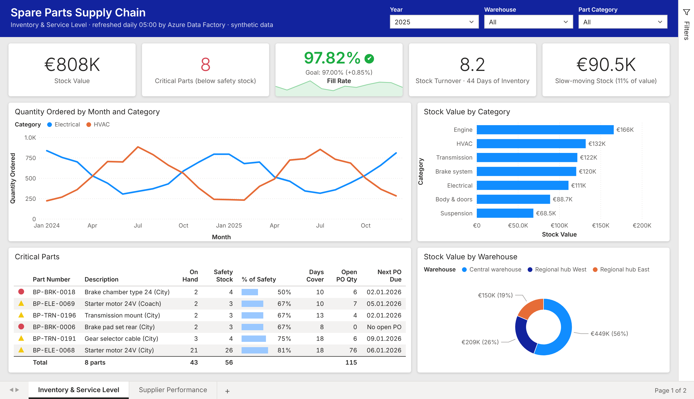
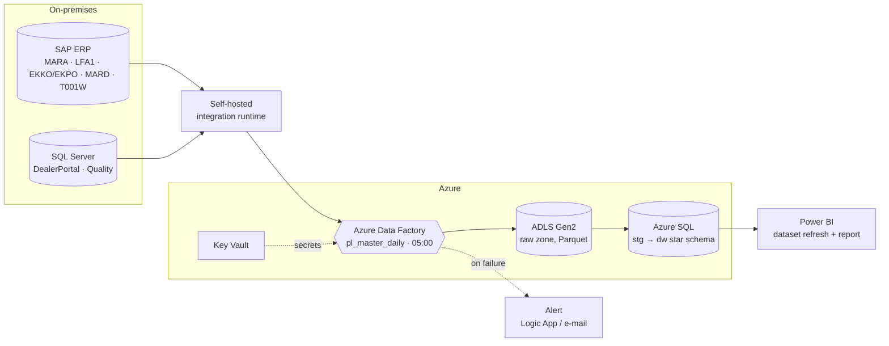
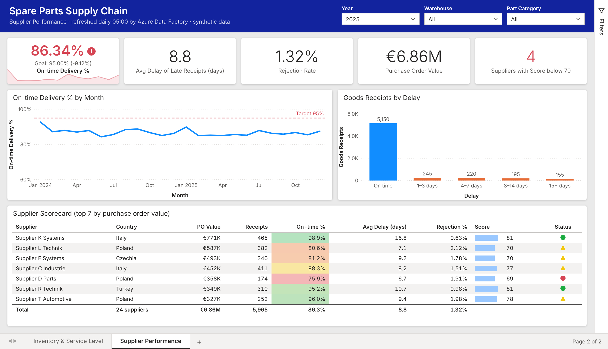

# Spare Parts Supply Chain Analytics

**Azure Data Factory pipeline + Power BI dashboard for an after-sales spare-parts business.**
Six feeds from SAP ERP and on-premises SQL Server are ingested daily, modelled into a star schema in Azure SQL and turned into a Power BI report that shows stock health, service level to dealers and supplier performance.



## Background

I built this kind of solution as an in-house analytics engineer for the spare-parts (after-sales) organisation of a bus manufacturer. Planners and purchasing were working from separate ERP exports and spreadsheets, so nobody had one view of which parts were about to run out, which suppliers were late and where money was tied up in stock.

The company's data, report and code stay with the company. **This repository is a clean re-implementation of the same architecture on fully synthetic data**: every part number, supplier, dealer, price and quantity is generated by `generator/generate.py`. The dashboard pages are a recreation of the report layout in Power BI's default visual style (theme colours, cards, KPI visuals, tables with conditional formatting) using the same measures, not the original report.

## Architecture



### The six feeds

| # | Feed | Source | Load |
|---|---|---|---|
| 1 | Material master: part, category, standard price, lead time, safety stock (`MARA`) | SAP ERP | full |
| 2 | Vendor master (`LFA1`) | SAP ERP | full |
| 3 | Purchase orders, header + items (`EKKO`, `EKPO`) | SAP ERP | changed since watermark |
| 4 | Month-end stock per warehouse (`MARD`, plants from `T001W`) | SAP ERP | full snapshot |
| 5 | Dealer / service-point orders (`service.DealerOrders`, `service.Dealers`) | SQL Server, DealerPortal | incremental (`ModifiedAt` watermark) |
| 6 | Goods receipts with requested date and rejected quantity (`qm.GoodsReceipts`) | SQL Server, Quality | incremental (`ModifiedAt` watermark) |

### Azure Data Factory ([`adf/`](adf/))

| Pipeline | What it does |
|---|---|
| `pl_ingest_erp` | ForEach over SAP tables → Parquet in the lake (`raw/erp/<table>/load_date=…`), SAP Table connector through the self-hosted IR |
| `pl_ingest_sqlserver` | ForEach over SQL Server tables: look up old and new watermark → copy only changed rows → update `control.Watermark` |
| `pl_load_dw` | Lake → `stg` tables (truncate + copy) → `dw.usp_LoadDimensions` → `dw.usp_LoadFacts` (MERGE) → `control.usp_DataQualityChecks` |
| `pl_master_daily` | Runs both ingestions in parallel, then the warehouse load, then refreshes the Power BI dataset via REST (managed identity); posts an alert if any step fails |
| `tr_daily_0500` | Schedule trigger, every day 05:00 CET, so the report is current when planners start |

Credentials live in Key Vault; Azure services use managed identity. Copy activities retry twice. The JSON files are in the format ADF's Git integration writes, so they can be imported into a factory as they are.

### Azure SQL model ([`sql/azure/`](sql/azure/))

```
dim_date ─┬─ fact_dealer_order_line ── dim_dealer
dim_part ─┤  fact_purchase_order_line ─ dim_supplier
dim_warehouse ┤  fact_goods_receipt
          └─ fact_stock_monthly
```

- `01_schemas_and_control.sql`: `stg`, `dw` and `control` schemas, watermark table, data-quality log, staging tables
- `02_star_schema.sql`: 5 dimensions, 4 fact tables at their natural grain (order line, PO item, goods receipt, month-end stock)
- `03_load_procedures.sql`: MERGE-based dimension and fact loads in one transaction each, and data-quality checks that stop the pipeline on errors (unknown parts, receipts without a PO, shipped > ordered, negative stock)

### Power BI ([`powerbi/measures.dax`](powerbi/measures.dax))

Measures in display folders: **Inventory** (semi-additive Stock Value, Critical Parts, Slow-moving Stock), **Demand & service level** (Fill Rate, Backorder Lines, YoY), **Turnover** (Stock Turnover, Days of Inventory), **Supplier performance** (On-time Delivery %, Average Delay, Rejection Rate, Supplier Score) and conditional-formatting helpers.



## Results on the synthetic data (2025)

| KPI | Value |
|---|---|
| Stock value at year end | €808k across 201 parts and 3 warehouses |
| Parts below safety stock | 8 |
| Fill rate to dealers | 97.8% of ordered quantity |
| Stock turnover | 8.2× (44 days of inventory) |
| Slow-moving stock (> 12 months cover) | €90.5k, 11% of stock value, 8 parts |
| Supplier on-time delivery | 86.3% against a 95% target; late receipts average 8.8 days |
| Rejection at incoming inspection | 1.32% |

The generator builds in the patterns the report was meant to surface: seasonal demand (electrical parts peak in winter, HVAC in summer), legacy parts from discontinued models that tie up stock, and suppliers that differ in punctuality and quality.

## Run it locally

No Azure subscription needed: the same model is built with DuckDB (`sql/local/build_dw.sql`).

```bash
pip install -r requirements.txt

python generator/generate.py --out data/raw     # six synthetic feeds, 2 years (~5 s)
python pipeline/run_local.py                    # staging → star schema → quality checks → KPIs (docs/kpis.json)
python dashboard/render.py                      # dashboard pages → docs/img/*.png (Playwright + Chromium)
pytest -q                                       # 5 tests
```

To deploy on Azure: run `sql/azure/*.sql` against the Azure SQL database, connect the factory to this repository (or import `adf/`), create the self-hosted integration runtime `ir-selfhosted-onprem`, and add the secrets `sap-erp-password` and `sqlserver-onprem-password` to Key Vault.

## Project structure

```
generator/generate.py      synthetic SAP and SQL Server extracts
adf/                       linked services, datasets, pipelines, trigger (ADF JSON)
sql/azure/                 T-SQL: schemas, star schema, MERGE loads, data-quality checks
sql/local/build_dw.sql     same model in DuckDB
pipeline/run_local.py      local load + KPI calculation
powerbi/measures.dax       DAX measures
dashboard/render.py        recreation of the two report pages in Power BI's default style
dashboard/fonts/           Open Sans (SIL OFL), used when Segoe UI is not installed
tests/                     pytest
```

---

Built by **Tolga Boroğlu** · Analytics Engineer & Data Analyst
